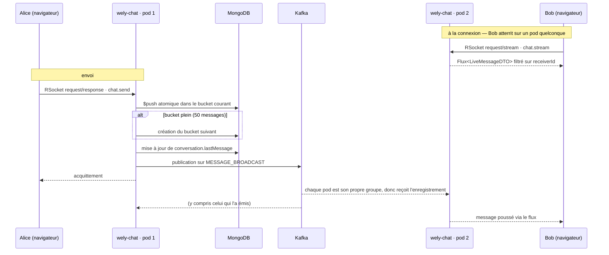

# wely-chat

> **Les topics portent leur environnement en préfixe** (`dev.`, `prod.`) depuis le 2026-10-24 :
> un seul broker sert tous les environnements, et le préfixe est la seule chose qui les sépare.
> Côté service, une seule variable le porte — `TOPIC_PREFIX` — et les destinations s'écrivent
> `${TOPIC_PREFIX}user-created`. Aucune valeur par défaut : un service incapable de nommer ses
> topics refuse de démarrer plutôt que de rejoindre le trafic d'un autre environnement.

Service de **messagerie temps réel** de la plateforme [Wely Calendar](https://github.com/WelyLabs/wely-platform).

C'est le service le plus intéressant techniquement du projet : communication bidirectionnelle en RSocket, contre-pression native, et un *bucket pattern* MongoDB pour le stockage des messages.

---

## Rôle

| | |
|---|---|
| **Port** | 8084 (HTTP **et** RSocket over WebSocket) |
| **Préfixe HTTP** | `/chat-service` (exposé sur `/api/v1/chat-service/**`) |
| **Chemin RSocket** | `/rsocket` |
| **Base** | MongoDB (driver réactif) |

---

## Stack

Java 25 · Spring Boot 4 · WebFlux · **RSocket** · Spring Data MongoDB réactif · Spring Security RSocket · MapStruct · Lombok

---

## Pourquoi RSocket plutôt que WebSocket

Un WebSocket brut est un tuyau d'octets : il faut inventer son propre protocole applicatif — format d'enveloppe, routage des messages, corrélation requête/réponse, et surtout gestion du débit.

RSocket fournit tout cela nativement :

| | |
|---|---|
| **Modèles d'interaction** | `fire-and-forget`, `request/response`, `request/stream`, `channel` — ici `request/response` pour l'envoi et `request/stream` pour la réception |
| **Contre-pression** | Le consommateur déclare sa demande (`request(n)`) ; le serveur n'émet jamais plus que demandé. C'est la sémantique Reactive Streams portée sur le réseau |
| **Routage** | Métadonnée `MESSAGE_RSOCKET_ROUTING` — `chat.send`, `chat.stream` — au lieu d'un champ `type` maison |
| **Authentification** | Métadonnée `MESSAGE_RSOCKET_AUTHENTICATION` portant le JWT, validée par Spring Security RSocket |

Sur une stack déjà entièrement Reactor, c'est le protocole cohérent : la contre-pression est de bout en bout, du curseur MongoDB jusqu'au navigateur.

---

## Le bucket pattern

### Le problème

Un document par message donne, pour une conversation active, des dizaines de milliers de documents. Chaque chargement de conversation devient une requête paginée avec tri, et l'index sur `conversationId` grossit indéfiniment.

### La solution

Les messages sont groupés par **50 dans un document `MessageBucket`** :

```
   conversations                        message_buckets
┌──────────────────────┐        ┌────────────────────────────────┐
│ _id                  │        │ _id                            │
│ participantIds[]  🔍 │◀──────▶│ conversationId                 │
│ lastMessage          │        │ bucketIndex : 0                │
│ updatedAt            │        │ messages[ 50 ]  ← messages 1-50│
└──────────────────────┘        ├────────────────────────────────┤
                                │ bucketIndex : 1                │
  aperçu pour la liste          │ messages[ 50 ]  ← messages 51-100
  des conversations             ├────────────────────────────────┤
                                │ bucketIndex : 2                │
                                │ messages[ 12 ]  ← en cours     │
                                └────────────────────────────────┘
```

**Ouvrir une conversation** = lire **un seul document**, le bucket d'index le plus élevé.
**Remonter l'historique** = décrémenter `bucketIndex`, une requête par page de 50.
**Lister les conversations** = lire les documents `conversations`, qui portent déjà `lastMessage` en aperçu — sans toucher aux messages.

### Compaction des champs

Les noms de champs sont stockés abrégés et remappés par la couche de persistance :

```java
public record MessageEntity(
        @Field("m_id") String messageId,
        @Field("s_id") String senderId,
        @Field("s_un") String senderName,
        @Field("txt")  String content,
        @Field("ts")   LocalDateTime timestamp
) {}
```

MongoDB stocke le nom de chaque champ dans chaque document : avec 50 messages par bucket, l'économie est réelle. Le domaine, lui, ne voit que des noms explicites.

---

## Architecture

```
  RSocket                     ┌──────────────────────────────────────┐
  chat.send    ──────────────▶│          application/                │
  chat.stream                 │   messaging/ MessageSocketController │
  HTTP         ──────────────▶│   rest/      ConversationController  │
                              └──────────────────┬───────────────────┘
                                                 │
                              ┌──────────────────▼───────────────────┐
                              │              domain/                 │
                              │   services/ ChatService (POJO)       │
                              │   models/   Message · MessageBucket  │
                              │             ConversationDetail       │
                              │             ConversationSummary      │
                              │   ports/    ChatRepository           │
                              │             MessageBroadcaster       │
                              └────────▲──────────────────▲──────────┘
                                       │                  │
                    ┌──────────────────┴───┐   ┌──────────┴──────────────────┐
                    │   infrastructure/    │   │      infrastructure/        │
                    │ MongoChatRepository  │   │ KafkaMessageBroadcaster     │
                    │   Adapter            │   │   ou LocalMessageBroadcaster│
                    │  → ConversationRepo  │   │ MessageBroadcastConsumer    │
                    │  → MessageBucketRepo │   └──────────┬──────────────────┘
                    └──────────┬───────────┘              ▼
                               ▼                 Kafka · MESSAGE_BROADCAST
                           MongoDB
```

La diffusion est un **port du domaine**, pas un détail du service. `ChatService` ne connaît que
`MessageBroadcaster` ; c'est `chat.broadcast.mode` qui décide, au démarrage, si l'implémentation
est en mémoire ou passe par Kafka.

---

## Flux d'un message



L'ordre compte : la persistance **avant** la diffusion. Diffuser d'abord ferait apparaître chez
le destinataire un message qu'une écriture en échec n'aurait jamais enregistré.

La réception passe par un **flux unique par utilisateur** (`chat.stream`), pas par un flux par conversation : un seul abonnement RSocket suffit à recevoir tous les messages, quelle que soit la conversation ouverte.

Chaque trame porte les champs du message, à plat, et un champ `kind` : `NEW` s'ajoute au fil, `UPDATED` remplace le message de même `id` (aujourd'hui : une photo retirée). Un enregistrement Kafka sans `kind`, publié par un pod antérieur pendant un déploiement, est lu comme `NEW`.

```json
{"id":"…","senderId":"…","senderName":"alice","receiverId":"…","conversationId":"…","content":"Le podium",
 "timestamp":"2026-10-13T20:00:00Z","photo":{"key":null,"width":0,"height":0,"url":null,"removed":true},"kind":"UPDATED"}
```

---

## API

### OpenAPI

La spécification est générée par `springdoc-openapi` et servie sans jeton :

| | |
|---|---|
| Spec JSON | `http://localhost:8084/v3/api-docs` |
| Swagger UI | `http://localhost:8084/swagger-ui.html` |

Ces deux chemins ne sont **pas** routés par la gateway, et le Service est en `ClusterIP` : rien
hors du cluster ne peut les atteindre. La documentation reste donc active en permanence — c'est
la topologie réseau qui la protège, pas un drapeau.

> Le préfixe de chemin du service est appliqué par package (`…application.rest`) et non par
> annotation. Sélectionner sur `@RestController` attrapait aussi le contrôleur de springdoc, ce
> qui déplaçait la spec en `/chat-service/v3/api-docs` derrière l'authentification.

### RSocket — routes

| Route | Modèle | Description |
|---|---|---|
| `chat.send` | `request/response` | Envoie un message. L'expéditeur est lu dans le JWT, jamais dans le payload |
| `chat.stream` | `request/stream` | Flux des messages destinés à l'utilisateur courant, nouveaux (`kind: "NEW"`) ou modifiés (`kind: "UPDATED"`) |
| `call.events` | `request/stream` | Événements d'appel destinés à l'utilisateur : `RINGING`, `PARTICIPANT_JOINED`, `PARTICIPANT_LEFT`, `TRACKS_PUBLISHED`, `DECLINED`, `ENDED` |

Le JWT est transmis dans la métadonnée d'authentification RSocket et validé par Spring Security RSocket.

### HTTP

Préfixées par `/chat-service`, exposées sur `/api/v1/chat-service/**`.

| Méthode | Route | Description |
|---|---|---|
| `GET` | `/conversations?friendId=` | Récupère **ou crée** la conversation avec cet ami |
| `GET` | `/conversations/all` | Liste des conversations de l'utilisateur : participants et aperçu du dernier message |
| `GET` | `/conversations/{id}` | Détail d'une conversation (dernier bucket de messages) |
| `GET` | `/conversations/{id}/loadMessages?bucketIndex=` | Remonte l'historique, bucket par bucket |
| `POST` | `/conversations/{id}/photos` | Envoie une photo (multipart `file`, `caption` facultatif) : un message qui la porte, 201 |
| `GET` | `/conversations/{id}/photos?before=&limit=` | L'onglet Médias : les photos de la conversation, les plus récentes d'abord, 30 par page (60 au plus) |
| `DELETE` | `/conversations/{id}/photos/{messageId}` | Retire une photo (204) : son auteur, ou l'organisateur dans le groupe d'un événement |
| `GET` | `/presence/{userId}` | En ligne ou pas, et vu pour la dernière fois quand — seulement pour quelqu'un avec qui on a une conversation |
| `POST` | `/calls` | Lance un appel (`{conversationId, media: AUDIO\|VIDEO}`) et fait sonner les autres membres, ou rend l'appel déjà en cours |
| `GET` | `/calls/live?conversationId=` | L'appel en cours de la conversation, 204 s'il n'y en a pas |
| `POST` | `/calls/{id}/join` | Entre dans l'appel : serveurs ICE (STUN, TURN éphémère) |
| `POST` | `/calls/{id}/publish` | Publie micro et caméra : l'offer SDP du navigateur contre l'answer du SFU |
| `POST` | `/calls/{id}/subscribe` | Reçoit les pistes d'autres participants, nommées par personne |
| `PUT` | `/calls/{id}/renegotiate` | L'answer du navigateur quand le SFU a renégocié |
| `PUT` | `/calls/{id}/layers` | Change la couche simulcast d'une caméra reçue |
| `POST` | `/calls/{id}/unsubscribe` · `/heartbeat` · `/leave` · `/decline` | Ferme des pistes reçues · signe de vie toutes les 15 s · quitte · refuse |

### Modèles

```java
public record Message(String id, String senderId, String senderName,
                      String receiverId, String conversationId,
                      String content, LocalDateTime timestamp) {}

public record MessageBucket(String conversationId, Integer bucketIndex,
                            List<Message> messages) {}

public record ConversationSummary(String id, ConversationType type, String title,
                                  LocalDateTime updatedAt, Message lastMessage) {}
```

`ConversationType` prévoit `DIRECT`, `GROUP` et `EVENT` ; seul `DIRECT` est implémenté à ce jour.

---

## Photos

Comme dans une messagerie : une photo s'envoie dans la conversation, s'affiche dans le fil et se retrouve dans un onglet Médias.

- **Confiées à wely-media**, sous la clé `chat/<conversation>/<message>.jpg` (préfixe `chat/`, le seul que wely-media accepte de ce service). Le chat n'accède jamais au bucket : il appelle l'API interne de wely-media (`/internal/media`, en-tête `X-Internal-Secret`) via `MediaApiAdapter`, derrière le port `MediaStore`.
- **Préparées par wely-media** (profil `PHOTO`) : vérification du type, côté le plus long ramené à 1600 px, réencodage JPEG, métadonnées (dont la position GPS) retirées. L'orientation EXIF est appliquée par l'application web, qui redessine la photo sur un canvas avant l'envoi. 10 Mo au plus, refusés par le chat avant tout appel. Image refusée → `CHT-BUS-004`, trop lourde → `CHT-BUS-005`, toute autre erreur de wely-media → `CHT-TEC-001`.
- **URL signées à la lecture** : le message garde la **clé** et la taille, jamais une URL. Chaque réponse (bucket d'historique, détail de conversation, page de l'onglet Médias, message du flux RSocket) demande ses URL en **un seul appel** `POST /internal/media/urls` (par lots de 200 clés), valables **1 h**. C'est le pod qui livre le message qui signe — la clé seule passe par Kafka. Si wely-media ne répond pas, la réponse part quand même, photos sans `url`, et un avertissement est journalisé.
- **Ordre des écritures** : le fichier d'abord, puis le message ; si le message échoue, le fichier est supprimé. L'entrée de l'onglet Médias vient en dernier et ne fait pas échouer l'envoi.
- **Qui voit** : les membres **actuels** de la conversation. Rejoindre le groupe d'un événement donne accès aux photos d'avant ; le quitter retire l'accès.
- **Événement supprimé** : `EVENT_GROUP_CHANGED` arrive avec `deleted: true`. Le groupe est vidé (plus aucun membre, plus aucun message) et ses photos sont supprimées, fichiers compris. Le document de conversation reste, vide, avec sa version : un ancien message de groupe arrivé en retard est reconnu comme plus vieux et ignoré, au lieu de recréer le groupe.
- **Qui retire** : l'auteur, et dans le groupe d'un événement son organisateur — nommé par `EVENT_GROUP_CHANGED` (`organizerId`), ou à défaut le premier membre, là où wely-events l'a toujours placé. Le message reste, marqué « photo retirée », pour que le fil garde sa forme ; le fichier part ensuite (un échec laisse un fichier orphelin, pas un message cassé). Le retrait est **poussé en direct** : le message, relu dans son bucket, est rediffusé aux autres membres avec `kind: "UPDATED"` ; un échec de diffusion ne fait pas échouer le retrait.
- **Onglet Médias** : une collection à part, `conversation_photos` (`{conversationId, sentAt}`, unicité sur `{conversationId, messageId}`), pour paginer sans dérouler les buckets de 50 messages.
- **Identifiants de message** : attribués par le serveur (UUID) à chaque envoi — une photo se retire par l'identifiant du message qui la porte.

## Appels audio et vidéo

Un appel appartient à une conversation, directe ou le groupe d'un événement : on appelle un ami, ou tous les participants d'une sortie (12 au plus).

- **Le média ne passe jamais par ici.** Chaque navigateur ouvre **une** connexion WebRTC vers le SFU de **Cloudflare Realtime**, y publie son micro et sa caméra, et y reçoit les pistes des autres. Un SFU fait suivre les flux sans les réencoder : chacun n'envoie qu'un flux, quel que soit le nombre de participants — là où un maillage pair-à-pair ferait envoyer `n-1` flux à chaque téléphone.
- **Ce service fait le reste** : il vérifie l'appartenance, fait sonner les membres, tient l'état de l'appel dans MongoDB (collection `calls`) et relaie la négociation WebRTC (offer/answer SDP) vers l'API Cloudflare avec un secret que le navigateur ne voit jamais.
- **Le client ne nomme jamais une session Cloudflare.** Publier se fait sur *sa* session, retrouvée dans l'appel stocké à partir du JWT ; recevoir une piste n'est permis que si un participant de *cet* appel la publie (`CHT-BUS-010` sinon). Les identifiants de session ne sortent pas du service.
- **Un seul appel vivant par conversation**, garanti par un index unique partiel (`conversationId` où `live: true`) : deux membres qui appellent à la même seconde se retrouvent dans le même appel, et un seul fait sonner les autres. La dernière place est prise par une écriture conditionnelle (`$expr` sur la taille de la liste), jamais par une lecture suivie d'une écriture.
- **États** : `RINGING` → `ACTIVE` (un deuxième participant entre) → `ENDED` (le dernier sort). `MISSED` si personne ne répond en 30 s ou si l'appelant raccroche avant ; `DECLINED` si l'autre refuse un appel direct. Dans un groupe, un refus prévient seulement ceux qui sont dans l'appel.
- **Nettoyage** (`CallReaper`, toutes les 10 s, sur chaque pod) : sonnerie expirée, participant sans *heartbeat* depuis 45 s (onglet fermé, réseau perdu), appel de plus de 3 h — garde-fou sur le quota gratuit de Cloudflare (1 000 Go sortants par mois). Les écritures conditionnelles font qu'un seul pod agit sur chaque appel.
- **Historique** : la fin d'un appel laisse une ligne système dans la conversation (« 📞 Appel vidéo · 12 min », « 📞 Appel audio manqué »), une seule fois grâce à un identifiant dérivé de l'appel.
- **Diffusion** : les événements suivent le même chemin que les messages (`CallBroadcaster`, local ou Kafka, topic `CALL_EVENTS`).
- **Caller name**: `POST /calls` stores the caller's `preferred_username` as `startedByName`, returned in every call (REST, `call.events`, `CALL_EVENTS`) so ringing screens and notifications can say who is calling. It is `null` on calls stored before it existed, and on events from an older instance.
- **TURN** : identifiants éphémères (4 h) demandés à Cloudflare à chaque entrée dans un appel ; sans clé, ou si Cloudflare échoue, STUN seul.

## Gestion des erreurs

| Code | HTTP | Signification |
|---|---|---|
| `CHT-BUS-001` | 404 | Conversation introuvable **ou** n'appartenant pas à l'appelant |
| `CHT-BUS-002` | 404 | Page d'historique inexistante à cet index |
| `CHT-BUS-003` | 404 | Présence indisponible : utilisateur inconnu **ou** sans conversation commune |
| `CHT-BUS-004` | 400 | Photo refusée : pas une image acceptée, ou trop grande en pixels ; légende trop longue |
| `CHT-BUS-005` | 413 | Photo de plus de 10 Mo |
| `CHT-BUS-006` | 404 | Pas de photo pour ce message dans cette conversation |
| `CHT-BUS-007` | 403 | Ni l'auteur de la photo, ni l'organisateur de l'événement |
| `CHT-BUS-008` | 404 | Appel introuvable, terminé, **ou** dont l'appelant n'est pas membre |
| `CHT-BUS-009` | 409 | Appel complet (12 participants) |
| `CHT-BUS-010` | 403 | Piste qui n'est pas publiée dans cet appel |
| `CHT-BUS-011` | 410 | Account deleted: its writes and new streams are refused |
| `CHT-BUS-012` | 409 | Read-only private conversation: the other participant deleted their account |
| `CHT-BUS-013` | 403 | Friends only: a private conversation is opened, written to and called in between friends |
| `CHT-TEC-001` | 502 | wely-media injoignable ou en erreur |
| `CHT-TEC-002` | 502 | Cloudflare Realtime injoignable, en erreur ou non configuré |
| `CHT-TEC-003` | 502 | wely-users' list of deleted accounts unreadable or not configured (reconciliation only, never sent to a client) |
| `CHT-TEC-004` | 502 | MongoDB unreachable, on the account-deletion paths (marker, erasure) |
| `CHT-VAL-001` | 400 | Validation du corps de requête, détail par champ |
| `CHT-REQ-000` | *repris* | Chemin inconnu, méthode non autorisée |
| `CHT-TEC-000` | 500 | Erreur inattendue |

**`CHT-BUS-001` confond volontairement « inexistante » et « pas la tienne ».** Distinguer les
deux permettrait d'énumérer les identifiants de conversation et d'apprendre lesquels existent.

Toutes les réponses d'erreur sont des `ProblemDetail` (RFC 7807), avec un `code` stable qu'un
client peut tester et un `timestamp` :

```json
{
  "type": "https://welylabs.app/problems/cht-bus-001",
  "title": "Conversation not found",
  "status": 404,
  "detail": "No conversation matches the given identifier for this user.",
  "instance": "/chat-service/conversations/4a1b…",
  "code": "CHT-BUS-001",
  "timestamp": "2026-09-30T19:23:43.598673Z"
}
```

> `CHT-REQ-000` rend le statut d'origine d'une `ResponseStatusException` — 404 sur un
> chemin inconnu, 405 sur une méthode non autorisée. Sans lui, le handler `Exception.class`
> les avalait toutes et **tout chemin inconnu répondait 500**. C'est le genre de défaut qu'un
> test de route nominale ne voit jamais.

### Erreurs RSocket

Une route RSocket (`chat.send`, `chat.stream`, `call.events`) qui échoue répond toujours par une
trame d'erreur `APPLICATION_ERROR`, mais ses données ne sont plus le seul texte du `detail` : c'est
un **problème JSON**, avec les mêmes codes et les mêmes champs qu'une réponse HTTP, sans `instance`.

```json
{
  "type": "https://welylabs.app/problems/cht-bus-011",
  "title": "Account deleted",
  "status": 410,
  "detail": "This account has been deleted.",
  "code": "CHT-BUS-011",
  "timestamp": "2026-10-20T10:15:30.123Z",
  "requestId": "3f2b8c1e-7d4a-4e9b-9a51-0c6e2f8d1b7a"
}
```

- **Échec métier** (`CHT-BUS-*`) : son code et son statut, journalisé en WARN sans pile.
- **Échec technique** (`CHT-TEC-*`) : son code, journalisé en ERROR avec la cause, compté dans
  `wely_errors_technical_total{source="rsocket"}`.
- **Tout le reste** : `CHT-TEC-000`, avec un `detail` générique qui ne laisse rien fuiter.
- **`requestId`** : l'identifiant que le client envoie dans la métadonnée
  `message/x.wely.request-id` (texte, 8 à 64 lettres, chiffres ou tirets), sinon un UUID généré et
  cité dans la ligne de journal.

**Changement de contrat** : wely-web et wely-ios lisent les données de la trame comme du JSON et
retombent sur le texte brut si elles n'en sont pas (serveur plus ancien, erreur du transport). Un
refus d'authentification est prononcé par l'intercepteur de sécurité avant toute route et garde
son propre format. Implémentation : `RSocketErrorHandler`, un `@ControllerAdvice` dont le
`@MessageExceptionHandler` voit aussi bien l'échec levé par la méthode de route que celui émis plus
tard par son `Mono` ou son `Flux`.

---
## Configuration

| Variable | Description |
|---|---|
| `MONGODB_URI` | URI de connexion MongoDB |
| `KEYCLOAK_ISSUER_URI` | Issuer public — validation de l'émetteur |
| `KEYCLOAK_INTERNAL_JWK_SET_URI` | JWKS interne — récupération des clés |
| `CHAT_BROADCAST_MODE` | `kafka` (défaut) ou `local` — voir ci-dessous |
| `CHAT_BROADCAST_TOPIC` | Topic de diffusion, `MESSAGE_BROADCAST` par défaut |
| `KAFKA_BOOTSTRAP_SERVER` | Broker, en mode `kafka` uniquement |
| `KAFKA_KEY` / `KAFKA_SECRET` | Identifiants SASL/PLAIN |
| `MEDIA_API_URL` | URL de wely-media (`http://localhost:8085` en profil `dev`) |
| `MEDIA_API_SECRET` | Secret partagé avec wely-media, envoyé dans `X-Internal-Secret`. Vide par défaut : le service démarre, l'envoi de photos répond `CHT-TEC-001` |
| `HOSTNAME` | Nom du pod, fourni par Kubernetes ; sert à nommer le groupe de consommation |
| `CHAT_CALL_TOPIC` | Topic des événements d'appel, `CALL_EVENTS` par défaut |
| `CLOUDFLARE_REALTIME_APP_ID` / `CLOUDFLARE_REALTIME_APP_SECRET` | Application Realtime SFU. Vides par défaut : le service démarre, les appels répondent `CHT-TEC-002` |
| `CLOUDFLARE_TURN_KEY_ID` / `CLOUDFLARE_TURN_API_TOKEN` | Clé TURN. Vides : STUN seul, ce qui suffit sur la plupart des réseaux |
| `CHAT_USER_DELETED_ENABLED` | `true` by default; `false` unbinds the `<env>.user-deleted` consumer (see Account deletion) |
| `USERS_API_URL` | wely-users' in-cluster URL, read by the reconciliation (`http://localhost:8082` in the `dev` profile). Empty by default: the service starts, each pass fails with `CHT-TEC-003` |
| `DELETED_USERS_READER_SECRET` | Reader secret of wely-users' deleted-accounts list, sent in `X-Internal-Secret`; distinct from `MEDIA_API_SECRET`. Empty by default, same effect as above |
| `ACCOUNT_ERASURE_RECONCILIATION_ENABLED` | `true` by default; `false` stops the reconciliation loop |
| `FRIENDSHIP_STATE_CONSUMER_ENABLED` | `true` by default; `false` unbinds the `FRIENDSHIP_STATE` consumer, so no new private conversation can be opened |

---

## Diffusion des messages

Un message doit atteindre son destinataire **quel que soit le pod** sur lequel celui-ci a ouvert
son flux RSocket. Deux implémentations du port `MessageBroadcaster` répondent à ce besoin,
choisies par `chat.broadcast.mode` :

| Mode | Implémentation | Valide à |
|---|---|---|
| `local` | `LocalMessageBroadcaster` — `Sinks.Many` en mémoire | 1 réplica |
| `kafka` | `KafkaMessageBroadcaster` + `MessageBroadcastConsumer` | n réplicas |

**Le piège, en mode `kafka` :** Kafka répartit les enregistrements d'une partition entre les
membres d'un groupe de consommation — exactement un membre reçoit chaque enregistrement. C'est
ce qu'on veut pour une file de travail, et précisément ce qu'on ne veut pas ici : avec tous les
pods dans un même groupe, un message n'atteindrait qu'un pod, et que ce soit celui du
destinataire relèverait du hasard.

Chaque instance est donc **son propre groupe** (`chat-${HOSTNAME}`), ce qui la fait recevoir
tous les enregistrements. La contrepartie à assumer : le topic doit être en rétention courte et
sans compaction, puisque ces groupes sont jetables et que leurs offsets s'accumulent.

La diffusion reste au **mieux-effort**. C'est un canal de mise à jour temps réel, pas la source
de vérité : le message est déjà en base avant d'être diffusé, et un client qui a raté une frame
recharge la conversation. Exiger des acquittements et du rejeu pour une copie qui existe déjà
serait payer cher un problème qui n'existe pas.

Le binder n'est pas autorisé à créer le topic (`auto-create-topics=false`), mais le broker
déployé dans le cluster garde le défaut de Kafka (`auto.create.topics.enable=true`) : il le crée
au premier message, comme pour `<env>.user-created`. Rien à faire côté dev.

`CHAT_BROADCAST_TOPIC` existe pour qu'un topic par environnement reste possible — l'overlay dev
utilise `DEV_MESSAGE_BROADCAST`. C'est indispensable dès que plusieurs environnements partagent
un même broker : les identifiants utilisateur viennent du même realm Keycloak, donc un pod de
dev consommant le topic de prod livrerait ces messages à ses propres abonnés.

Sur un broker infogéré où la création automatique est désactivée, il faut créer le topic
d'avance, avec une rétention courte et sans compaction — les groupes de consommation étant
jetables, leurs offsets s'accumulent :

```bash
kafka-topics --create --topic DEV_MESSAGE_BROADCAST --partitions 3 --config retention.ms=300000
```

---

## Présence (« En ligne »)

Un utilisateur est **en ligne tant qu'il a un flux `chat.stream` ouvert**, sur n'importe quelle instance. Le service tourne à deux réplicas : une présence tenue en mémoire serait fausse une fois sur deux, elle est donc dans MongoDB, partagée.

| Collection | Contenu | Durée de vie |
|---|---|---|
| `presence_connections` | Un document par flux ouvert : utilisateur, instance, dernier rafraîchissement | Supprimé à la fermeture du flux ; **index TTL de 2 min** sinon |
| `last_seen` | Dernière fois où l'utilisateur a été vu connecté | Permanent |

- **Ouverture et fermeture** — `PresenceService.track` enveloppe le flux avec `Flux.usingWhen` : la connexion est enregistrée à l'abonnement et retirée à la fin, que le flux se termine, échoue ou soit **annulé** (fermer l'appli annule le flux).
- **Battement** — `PresenceHeartbeat` rafraîchit toutes les 30 s les connexions ouvertes sur l'instance, en une seule mise à jour. Un utilisateur est en ligne si l'une de ses connexions a été rafraîchie depuis moins de 90 s (trois battements : un battement manqué ne le fait pas clignoter).
- **Instance plantée** — elle ne ferme pas ses connexions ; elles sortent de la fenêtre de 90 s, puis l'index TTL les supprime. Personne ne reste « en ligne » pour toujours.
- **Best-effort** — si MongoDB refuse l'écriture, le flux s'ouvre quand même : le chat passe avant la présence.
- **Confidentialité** — `GET /presence/{userId}` ne répond que si l'appelant partage une conversation avec cette personne. Sinon `CHT-BUS-003`, identique pour un utilisateur inconnu, pour qu'on ne puisse pas sonder la présence de n'importe qui.

Le front relit la présence toutes les 30 s pendant qu'une conversation est ouverte et affiche « En ligne », « Vu à 14:32 », « Vu hier à 09:05 » ou « Vu le 3 oct. ».

## Private conversations between friends

A private conversation is opened, written to and called in only between two friends. wely-chat
does not ask wely-social on each request: it keeps its own copy of the friendships, the
`friendships` collection, fed by wely-social's compacted `FRIENDSHIP_STATE` topic
(`FriendshipStateConsumer`). A value makes the pair friends under a version guard; a tombstone
ends the friendship. The group reads from the earliest offset, so a new deployment rebuilds the
whole copy in a few seconds.

- Opening a conversation with someone who is not a friend answers `CHT-BUS-013` and creates nothing.
- A conversation with a former friend stays readable; writing, sending a photo or calling there answers `CHT-BUS-013`.
- Event groups need no friendship between their members.

The demo friendships are written straight into Neo4j, so they never reach the topic: the nightly
demo reset (wely-gitops-infra) seeds them into `friendships` too.

## Account deletion

wely-users publishes `<env>.user-deleted` (`{"userId", "deletedAt"}`) when an account is deleted. This
service then erases what it holds about the account, and keeps its messages under the
pseudonymous businessId.

- **Consumer** — `UserDeletedConsumer`, binding `userDeleted-in-0`, group `chat-service-group`
  shared by every pod (each record is erased once), `start-offset=earliest`. It is a
  `Function<Flux<Message<byte[]>>, Mono<Void>>`: Spring Cloud Stream subscribes to it and binds no
  output. An unreadable record is logged and skipped; a failed erasure is retried 5 times
  (backoff 1 s to 30 s), then logged and skipped.
- **Erasure** — `AccountErasureService`. MongoDB gives no transaction here, so every step is
  idempotent and the whole erasure can run again:
  1. a marker in `deleted_users` (`_id` = businessId, `deletedAt`, `erasedAt`), kept permanently:
     every guard refuses the account from this point;
  2. the account's `chat.stream` and `call.events` streams on this pod are completed;
  3. `s_un` is set to null on its messages (`message_buckets`, one atomic pipeline update per
     bucket through the multikey index `messages_sender`; a pipeline because Spring Data's
     `@Update` cannot declare `arrayFilters`) and on previews (`lastMessage`, in every
     conversation, including event groups the account has already left);
  4. its private conversations get `readOnly: true`;
  5. emptied event groups it organized lose their title and organizer (closing a group now drops
     both);
  6. in a live call, it leaves first, so a device still connected can no longer reopen tracks,
     then its Cloudflare session is closed; a ringing call it started, or a ringing private call
     to it, ends `ENDED`, never `MISSED`, so nobody is notified of a missed call from a deleted
     account; ended calls lose its session entries, and every call it started loses its
     `startedByName`;
  7. `presence_connections` and `last_seen` are deleted;
  8. `erasedAt` is set.
- **Kept** — message ids, `s_id`, text, photos, private conversations (read-only), and
  `startedBy` / `memberIds` of calls.
- **Guards** — from the marker. A deleted account's message, photo, photo removal, call start,
  join or decline, and stream opening answer `CHT-BUS-011` (410). A message, photo or call in a
  read-only conversation answers `CHT-BUS-012` (409). `GET /conversations?friendId=` never creates a
  conversation with a deleted friend: it returns the existing one or `CHT-BUS-001`. Presence is
  never re-created by the heartbeat or a stream closing.
- **Recipients** — message broadcasts skip deleted members, because past-event groups keep their
  id. When the markers cannot be read, a stored message is still acknowledged and only its live
  push is skipped: failing it would make the client resend a duplicate. Call events are not
  filtered: a group call's `memberIds` may name a deleted id, and wely-notifications drops what it
  receives for one.
- **Several pods** — the record reaches one pod. `LiveSessionSweeper` runs on every pod and, every
  30 s, completes the streams of accounts that now carry a marker. A completed stream (not a
  failed one) stops the web app from reconnecting.
- **Reconciliation** — Kafka is the fast path, not the guarantee. `DeletedUsersReconciliationLoop`
  pages wely-users' tombstones (`GET /user-service/internal/deleted-users`, reached on the
  wely-users Service with `X-Internal-Secret: DELETED_USERS_READER_SECRET`, 500 per page) one minute
  after startup, then every 24 h. It runs the same erasure for every tombstone whose marker is
  missing or has no `erasedAt`, and again for every account deleted less than 48 h ago, which
  sweeps writes made with a token still valid after the deletion. A pass that fails, or that
  counts a failed erasure, is retried after 1 h; a pass still running after 24 h (a hung query)
  is cut and retried 1 h later. Each pass logs one summary line (tombstones, erased, failed).
  Every pod runs it: the erasure is idempotent, so the duplicate work is harmless.
  It repairs a record lost by a pod that crashed mid-erasure (the reactive binding acknowledges a
  record as it arrives), a record skipped after its retries, a new consumer group, and a restored
  database.

## Démarrage

```bash
./mvnw spring-boot:run -Dspring-boot.run.profiles=dev
```

Le service expose HTTP et RSocket sur le même port 8084, RSocket étant monté sur `/rsocket` en transport WebSocket.

Pour lancer **toute la plateforme** (bases, Keycloak, gateway, frontend, les quatre services) en une commande sur un Kubernetes local :

```bash
git clone https://github.com/WelyLabs/wely-gitops-infra && cd wely-gitops-infra
kubectl apply -k overlays/local --server-side
```

---

## Tests

```bash
./mvnw test
./mvnw test jacoco:report      # → target-maven/site/jacoco/
```

> **Note build :** ce service produit dans `target-maven/` et non `target/`.

---

## Limites connues

- **La diffusion est au mieux-effort.** Un enregistrement perdu coûte un rafraîchissement, pas
  un message : le choix est assumé et documenté plus haut. Une garantie *at-least-once*
  demanderait un outbox côté producteur.
- **`@Transactional` est inopérant** : aucun `ReactiveMongoTransactionManager` n'est déclaré, la
  création conversation + bucket initial n'est donc pas atomique. L'ajout d'un message, lui, l'est
  désormais — c'est un `$push` conditionné sur l'absence de `messages.49`.
- **Les groupes de consommation s'accumulent.** Un groupe par pod, jetable : chaque redémarrage
  en laisse un derrière lui. Sans rétention courte sur le topic, ces offsets s'empilent côté
  broker ; une purge périodique des groupes inactifs reste à mettre en place.
- **`ConversationType` prévoit `GROUP` et `EVENT`**, seul `DIRECT` est implémenté.
- **Pas de test d'intégration.** Les adaptateurs MongoDB et Kafka sont testés contre des doubles ;
  Testcontainers validerait le `$push` conditionné et le round-trip Kafka contre de vraies
  instances. C'est le chantier suivant sur ce service.
